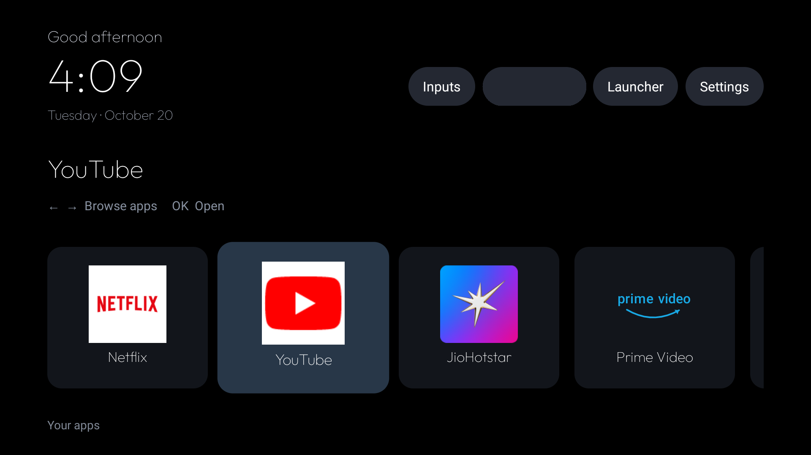

# AFT Home

A lightweight, native Android TV launcher for Fire TV. AFT Home presents installed apps in a horizontal chain on a black screen, with a clock, date, Wi-Fi shortcut, launcher switch, and a low-motion clock screensaver.



## At a glance

- Pinned app order: Netflix, YouTube, JioHotstar, Prime Video. Other Android TV apps follow alphabetically.
- D-pad browsing with a remembered last-focused app.
- A low-motion clock screensaver after two minutes of inactivity. It uses no video, blur, wallpaper downloads, or background network polling.
- A launcher chooser for AFT Home and Amazon Home.
- Outfit font bundled under the SIL Open Font License.

The detailed guide covers how the launcher works, how it was built and installed, and how to customize and restore it: [Installation and design guide](docs/INSTALL_AND_DESIGN.md).

## Build

Requirements: JDK 17 and Android SDK Platform 35 with Build Tools 35.0.0. Gradle 8.11.1 is included through the wrapper.

```sh
./build.sh
```

The debug APK is written to `app/build/outputs/apk/debug/app-debug.apk`. Install it on a connected Android TV device with:

```sh
adb install -r app/build/outputs/apk/debug/app-debug.apk
```

## Fire TV behavior

Fire OS protects Amazon's launcher as its system HOME activity. AFT Home cannot replace it through Android's normal HOME preference. To redirect the remote Home button, install and configure [Home on Fire](https://github.com/toolicious/home-on-fire) separately. This is an Accessibility-based redirect, not a replacement of Amazon's system launcher.

To let AFT Home pause or resume that redirect when choosing Amazon Home or AFT Home, grant this permission over ADB:

```sh
adb shell pm grant com.codex.afthome android.permission.WRITE_SECURE_SETTINGS
```

The app changes only Home on Fire's Accessibility service and preserves other enabled Accessibility services. Without this permission, the launcher still opens, but switching to Amazon Home may redirect back to AFT Home.

The Wi-Fi pill requests Location permission because Fire OS requires it to reveal the connected network name. Inputs for HDMI and AV display instructions to use the television remote; Fire TV apps cannot reliably switch inputs on the Samsung television itself. Live TV appears only when the Fire TV package is available.

## Project contents

- `app/src/main/java/com/codex/firetvhome/MainActivity.java` — UI, app discovery and launch, focus memory, launcher switching, and screensaver.
- `app/src/main/res/drawable-nodpi/` — AFT Home icon and banner.
- `app/src/main/assets/` — Outfit font and its license.
- `build.sh` — builds the debug APK.
- `tools/generate_logo.swift` — regenerates the launcher artwork.
- `docs/screenshots/` — selected TV screenshots; the Wi-Fi name has been masked in the public copies.

Device backups, ADB keys, package lists, local toolchains, and private device-control scripts are not part of this source release.

## License and trademarks

The AFT Home source code is licensed under the Apache License, Version 2.0. Outfit is separately licensed under the SIL Open Font License; see its included license file. AndroidX RecyclerView is distributed under the Apache License 2.0. Fire TV, Amazon, Prime Video, Netflix, YouTube, and JioHotstar are trademarks of their respective owners. This project is independent and is not affiliated with or endorsed by those companies.
