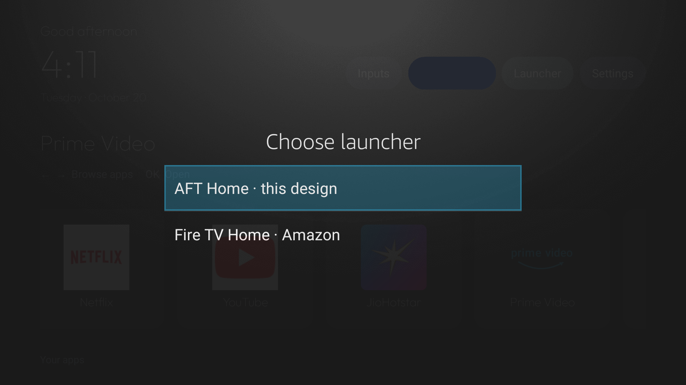

# AFT Home: how it works and how it was installed

AFT Home is a small native Java launcher built for a Fire TV device. It gives the user a quieter home screen, while Amazon's protected Fire TV Home remains installed and available.

## What the screen does


- The top left shows a greeting, large clock, and date in Outfit.
- The top right opens Inputs, Wi-Fi settings, the launcher chooser, and device Settings.
- A horizontal app chain begins with Netflix, YouTube, JioHotstar, and Prime Video. Additional Android TV apps are discovered from the installed apps and sorted by name.
- The focused tile grows and changes its background. Its name is also shown above the chain. Focus is remembered across launches.
- After two minutes without a remote key press, a black clock screensaver appears. Its clock drifts slowly and reduces screen brightness. Press any remote key to return.

## How the implementation is organized

The launcher is implemented in `app/src/main/java/com/codex/firetvhome/MainActivity.java`:

- `onCreate()` loads the bundled Outfit font, creates the screen, starts the clock/idle timers, and requests location permission for the Wi-Fi name.
- `buildScreen()` lays out the header controls, focused-app title, app ribbon, and screensaver layer.
- `loadApps()` adds the four pinned apps, then queries Android's Leanback launcher activities to find the rest. Missing pinned apps are skipped, so their order is preserved among apps that are installed.
- `AppsAdapter` binds app names and icons, animates focus, saves the last focused package, and launches selected apps.
- `showLauncherChooser()` offers AFT Home or Amazon Home.
- `setHomeRedirectEnabled()` controls only Home on Fire's Accessibility service while preserving other services. The app needs the ADB-granted `WRITE_SECURE_SETTINGS` permission to update that setting.
- `resetIdleTimer()`, `showScreensaver()`, and `ScreenSaver` handle inactivity, dimming, and the slow clock movement.

The Gradle project uses Android Gradle Plugin, the Gradle 8.11.1 wrapper, Java, and AndroidX RecyclerView. It sets `minSdk` 28, compiles against SDK 35, and targets SDK 28 for the older Fire OS behavior. Outfit is included with its SIL Open Font License. The build produces a debug APK; no signing key is required for local ADB installation.

## Why Fire TV needs a helper for the remote Home button



Fire OS protects Amazon's system launcher. Installing AFT Home does not make it the privileged system launcher, and setting a regular Android HOME preference cannot reliably replace Fire TV Home. The remote Home button can instead be redirected using [Home on Fire](https://github.com/toolicious/home-on-fire), which uses Android Accessibility. This is a redirect layer: Amazon Home stays installed and can be opened from AFT Home's **Launcher** control. On this device, enabling/disabling that redirect from the chooser also required granting AFT Home `WRITE_SECURE_SETTINGS` over ADB.

If you use Home on Fire with another launcher, follow its current setup instructions. Fire OS updates can change this behavior. Keep a recovery path to Fire TV Home.

## Build on a Mac

Install a JDK 17 and Android SDK Platform 35 with Build Tools 35.0.0. From the project root:

```sh
./build.sh
```

The APK is written to:

```text
app/build/outputs/apk/debug/app-debug.apk
```

## Install over ADB

1. Enable ADB debugging in Fire TV developer options and connect the TV and Mac to the same network.
2. Find the TV's IP address in the TV network settings or router. Connect on port 5555 if wireless debugging on the device uses that port:

   ```sh
   adb connect TV_IP_ADDRESS:5555
   adb devices
   ```

3. When Fire TV displays **Allow USB debugging?**, accept the prompt on the TV.
4. Install or update AFT Home:

   ```sh
   adb install -r app/build/outputs/apk/debug/app-debug.apk
   ```

5. To let the launcher chooser control Home on Fire's redirect, run:

   ```sh
   adb shell pm grant com.codex.afthome android.permission.WRITE_SECURE_SETTINGS
   ```

6. Install Home on Fire separately, select AFT Home as its target, and enable its Accessibility service if you want the remote Home button to open AFT Home. AFT Home itself remains launchable from Fire TV's Apps screen even when Home on Fire is not configured.

ADB versions on macOS can be affected by Local Network privacy. If `adb` reports `No route to host` even though port 5555 is reachable, allow the terminal/ADB client under macOS Local Network settings. If the stock client still cannot connect, a Python `adb-shell` client in a virtual environment is an alternative.

## Navigation and limitations

- Left and Right browse the app chain; OK launches the focused tile.
- The focused app name appears above the chain.
- The launcher chooser provides **AFT Home** and **Fire TV Home** options.
- Pressing any key dismisses the clock screensaver.
- HDMI and AV menu entries explain that the TV's own remote is needed; Fire TV cannot reliably switch inputs on the Samsung television itself.
- The Prime Video tile is special: Fire OS restricts direct launch of the Prime Video activity to Amazon-signed apps. The tile opens Amazon Home, where Prime Video remains available.
- Wi-Fi name display needs Location permission on this Fire OS version. If permission is denied, the pill falls back to “Wi-Fi.”

## Customizing the pinned app order

Edit the `addPinned()` calls in `loadApps()` in `MainActivity.java`, then rebuild and reinstall. Keep package IDs accurate for the target device; package names can differ between TV firmware and app versions.

To change the background, edit the `Color.BLACK` background assignment in `buildScreen()`. The screensaver background is drawn separately in `ScreenSaver.onDraw()`.

## Re-enable an app or restore the device

AFT Home does not require uninstalling system packages. If a separate debloat pass disabled apps, use that pass's restore script or run `pm enable --user 0 PACKAGE_NAME` for one known package. Do not guess package names. Keep the original package list and disabled-package list from the pre-change backup so you can restore accurately.

To return to Amazon Home, choose **Launcher → Fire TV Home**. If the redirect helper is misconfigured, use its settings to disable its Accessibility redirect or disable its service in Fire TV Accessibility settings. AFT Home can be opened again from Fire TV's app grid.

## Screenshot notes

The repository contains selected screenshots captured from the TV to document the launcher and its launcher switch. Public copies mask the personal Wi-Fi network name. Raw screenshots, package backups, ADB keys, and device state dumps should remain private.
